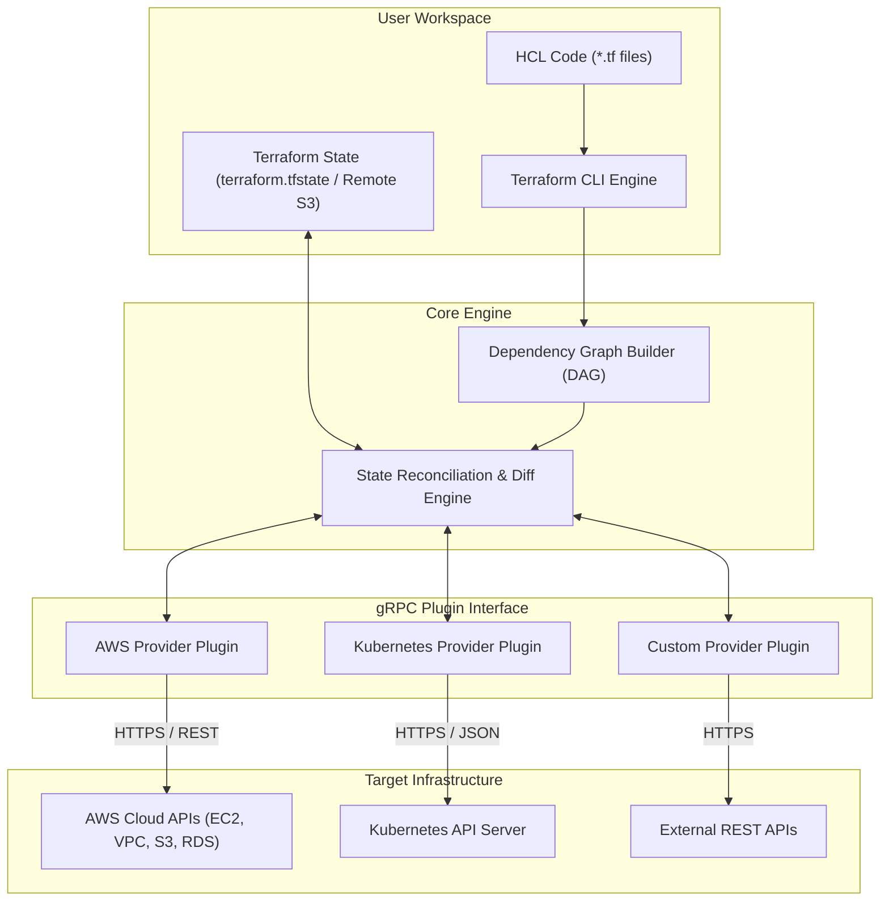
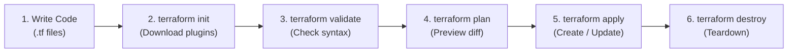
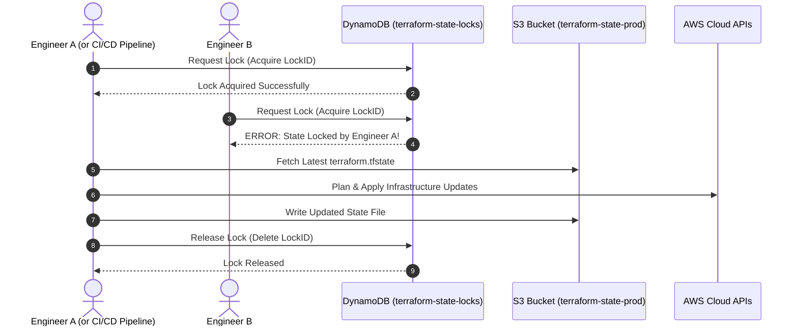
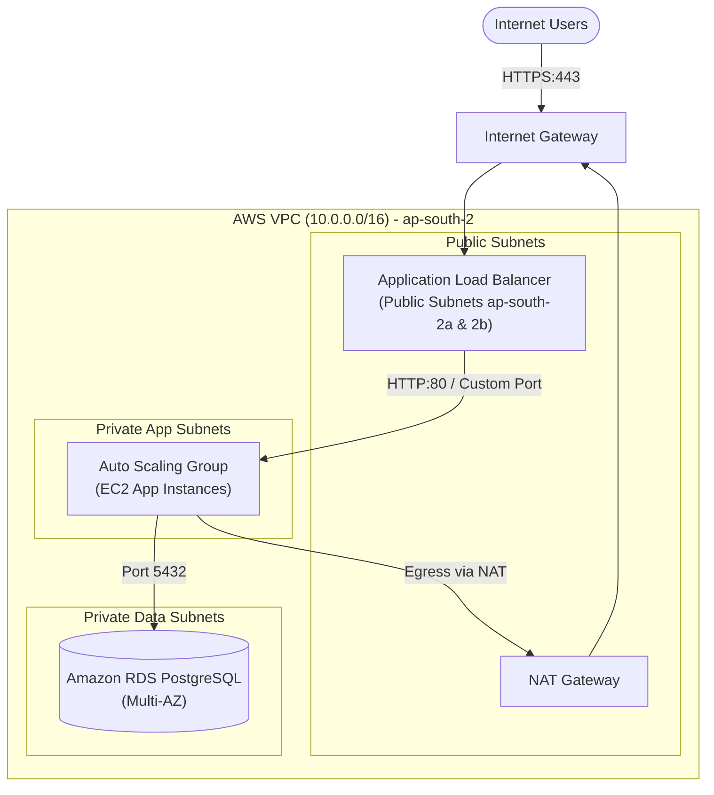

# Comprehensive Terraform Master Guide: From Fundamentals to Production DevOps

Welcome to the **Comprehensive Terraform Master Guide**. This guide provides a complete, production-grade reference for mastering **Terraform** by HashiCorp and **Infrastructure as Code (IaC)**, designed for DevOps engineers, Cloud architects, and SREs working with cloud infrastructure (specifically Amazon Web Services - AWS).

Whether you are preparing for real-world production deployments, designing highly available cloud platforms, or studying for technical interviews, this guide explains not just *what* commands to run, but *how* Terraform works under the hood and *why* specific industry patterns are adopted.

---

## 📑 Table of Contents

1. [What is Infrastructure as Code (IaC)?](#1-what-is-infrastructure-as-code-iac)
2. [What is Terraform & Why Do We Use It?](#2-what-is-terraform--why-do-we-use-it)
3. [Terraform Architecture & Internal Mechanics](#3-terraform-architecture--internal-mechanics)
4. [The Complete 6-Stage Terraform Workflow](#4-the-complete-6-stage-terraform-workflow)
5. [HashiCorp Configuration Language (HCL) Deep Dive](#5-hashicorp-configuration-language-hcl-deep-dive)
6. [The 8 Core Terraform Blocks](#6-the-8-core-terraform-blocks)
7. [Terraform State Management & Remote State](#7-terraform-state-management--remote-state)
8. [Remote Backend & Distributed State Locking](#8-remote-backend--distributed-state-locking)
9. [Terraform Workspaces & Multi-Environment Strategy](#9-terraform-workspaces--multi-environment-strategy)
10. [Resource Meta-Arguments & Lifecycle Rules](#10-resource-meta-arguments--lifecycle-rules)
11. [Provisioners & Modern Alternatives](#11-provisioners--modern-alternatives)
12. [AWS & Terraform Integration Architecture](#12-aws--terraform-integration-architecture)
13. [Real-World Production Infrastructure Implementation (3-Tier AWS Architecture)](#13-real-world-production-infrastructure-implementation-3-tier-aws-architecture)
14. [Production Directory Structure & Clean Code Standards](#14-production-directory-structure--clean-code-standards)
15. [Security, Governance & Best Practices](#15-security-governance--best-practices)
16. [Comprehensive Command Reference & CLI Operations](#16-comprehensive-command-reference--cli-operations)
17. [Interview Preparation Guide & Cross-References](#17-interview-preparation-guide--cross-references)

---

## 1. What is Infrastructure as Code (IaC)?

**Infrastructure as Code (IaC)** is the foundational DevOps engineering practice of managing, provisioning, and configuring computer data centers, networks, storage, compute instances, load balancers, and connection topologies using machine-readable definition files rather than manual interactive hardware configuration or web console point-and-click operations ("ClickOps").

### The Evolution of Infrastructure Management

```
┌─────────────────────────┐      ┌─────────────────────────┐      ┌─────────────────────────┐
│   Bare Metal / Manual   │ ───► │  Custom Shell Scripts   │ ───► │  Infrastructure as Code │
│  - Slow manual racking  │      │  - Brittle imperative   │      │  - Declarative state    │
│  - Configuration drift  │      │  - No state tracking    │      │  - Git version-controlled│
│  - Undocumented changes │      │  - Poor error recovery  │      │  - Automated CI/CD      │
└─────────────────────────┘      └─────────────────────────┘      └─────────────────────────┘
```

### Core Benefits of IaC

1. **Elimination of Configuration Drift:** Environments (Development, Staging, QA, Production) remain identical because they are generated from the same version-controlled code base.
2. **Speed & Scalability:** Entire environments containing hundreds of VPCs, subnets, firewalls, and clusters can be provisioned in minutes.
3. **Auditability & Traceability:** Every change is tracked through Git commits, pull requests, peer reviews, and automated security scans.
4. **Disaster Recovery (RTO / RPO Optimization):** In the event of a catastrophic regional failure, an entire cloud environment can be re-created in an alternate cloud region with a single pipeline trigger.
5. **Cost Optimization:** Temporary test environments can be automatically spun up for automated testing and destroyed upon pipeline completion (`terraform destroy`).

### Declarative vs. Imperative IaC

| Characteristic | Declarative (e.g., Terraform, CloudFormation) | Imperative (e.g., Bash, AWS CLI, Python Boto3) |
| :--- | :--- | :--- |
| **Philosophy** | You define **WHAT** the end-state should be. | You define **HOW** step-by-step to get there. |
| **State Awareness** | Maintains a state file; calculates the difference (diff). | Stateless; scripts must manually check if a resource already exists. |
| **Idempotency** | Naturally idempotent (running 10 times yields the exact same state). | Requires complex conditional checks (`if not exists`) to prevent duplicates. |
| **Refactoring** | Engine handles updates, deletions, and replacements automatically. | Developers must write custom teardown or modification scripts. |

---

## 2. What is Terraform & Why Do We Use It?

**Terraform** is an open-source Infrastructure as Code tool created by **HashiCorp** (first released in 2014 by Mitchell Hashimoto and Armon Dadgar). It enables cloud architects and DevOps engineers to write declarative configuration files that define cloud and on-premises resources.

### Why Industry Standardizes on Terraform

1. **Cloud-Agnostic & Multi-Cloud Unified Workflow:**
   Unlike vendor-locked tools such as AWS CloudFormation (AWS only), Azure Resource Manager (Azure only), or Google Cloud Deployment Manager (GCP only), Terraform provides a single syntax and consistent workflow across AWS, Azure, Google Cloud, Kubernetes, VMware, Cloudflare, GitHub, Datadog, and over 3,000 community and official providers.
2. **Deterministic Execution Planning (`terraform plan`):**
   Before touching live production infrastructure, Terraform evaluates the current live state against the desired state and presents an explicit dry-run diff (`+` create, `-` destroy, `~` update in-place).
3. **Automated Dependency Graph Engine:**
   Terraform builds a Directed Acyclic Graph (DAG) representing all resources and their relationships. It automatically calculates which resources can be created concurrently in parallel (e.g., independent subnets) and which must be sequenced sequentially (e.g., an EC2 instance waiting for its VPC and subnet).
4. **Enterprise Reusability via Modules:**
   Infrastructure patterns (such as an enterprise-grade VPC with private subnets, NAT gateways, and flow logs) can be packaged into reusable modules versioned via Git tags and shared across multiple teams.

---

## 3. Terraform Architecture & Internal Mechanics

Terraform's internal architecture is cleanly separated into two distinct components: **Terraform Core** and **Terraform Plugins (Providers)**. They communicate over local high-performance RPC (Remote Procedure Call) using gRPC.



### 1. Terraform Core
- **Input Processing:** Reads your `.tf` configuration files, variables, and modules.
- **State Reconciliation:** Reads the state file (`terraform.tfstate`) representing the last known reality.
- **Graph Construction:** Builds a Directed Acyclic Graph (DAG) mapping all resource dependencies.
- **Diff Calculation:** Compares desired configuration against real-world infrastructure and produces the execution plan.

### 2. Terraform Plugins (Providers)
- Independent executable binaries written in Go.
- Installed dynamically during `terraform init` into `.terraform/providers/`.
- Translate abstract Terraform CRUD requests (`Create`, `Read`, `Update`, `Delete`) into vendor-specific HTTP/HTTPS REST API calls (e.g., `aws ec2 run-instances`).

---

## 4. The Complete 6-Stage Terraform Workflow

The standard operational lifecycle for any Terraform-managed infrastructure follows six key stages:



### Stage 1: Write
Engineers declare the desired state in `.tf` files using HCL syntax, defining providers, resources, input variables, local values, and outputs.

### Stage 2: `terraform init`
Initializes the working directory. It:
- Scans configuration for `required_providers`.
- Downloads provider plugins into the local `.terraform/` cache directory.
- Creates or updates `.terraform.lock.hcl` with cryptographic checksums.
- Configures the backend (local or remote S3/GCS/Terraform Cloud) to store state.

### Stage 3: `terraform validate`
Verifies whether the configuration is syntactically valid and internally consistent without contacting remote cloud APIs. It checks argument names, required parameters, and type matching.

### Stage 4: `terraform plan`
Reads current infrastructure state via read APIs, compares it against your code, and creates an execution plan. It outputs what actions will occur:
- `+ create`: Resource will be created.
- `- destroy`: Resource will be deleted.
- `~ update in-place`: Attributes will be modified without destroying the resource.
- `-/+ destroy and re-create`: Changes to immutable attributes force resource recreation.

### Stage 5: `terraform apply`
Executes the planned changes against the target cloud APIs. By default, it requests user confirmation (`yes`) before sending mutation commands. Once provisioned, it writes the updated infrastructure IDs and metadata into the state file.

### Stage 6: `terraform destroy`
Reads the state file and terminates all managed resources in reverse dependency order, cleaning up test or decommissioned environments completely.

---

## 5. HashiCorp Configuration Language (HCL) Deep Dive

HCL is a declarative, human-readable language designed specifically for building infrastructure.

### Basic Syntax Structure

```hcl
<BLOCK_TYPE> "<BLOCK_LABEL_1>" "<BLOCK_LABEL_2>" {
  # Identifier = Expression / Value
  key = "value"
}
```

### Data Types in HCL

- **Primitive Types:**
  - `string`: `"ap-south-2"`
  - `number`: `42`, `8.5`
  - `bool`: `true`, `false`
- **Structural / Complex Types:**
  - `list(<TYPE>)`: Ordered sequence of values: `["subnet-1", "subnet-2"]`
  - `set(<TYPE>)`: Unordered collection of unique values: `toset(["t3.micro", "t3.small"])`
  - `map(<TYPE>)`: Collection of string key/value pairs: `{ "Environment" = "prod", "CostCenter" = "104" }`
  - `object({ ... })`: Schema with specified named attributes of different types.
  - `tuple([ ... ])`: Fixed-length sequence where each position has a specific type.

### HCL Expressions & Built-in Functions

HCL does not allow arbitrary scripts, but provides rich built-in functions:
- **String Manipulation:** `format("server-%02d", count.index)`, `lower()`, `upper()`, `join()`, `split()`.
- **Collection Functions:** `lookup(map, key, default)`, `element(list, index)`, `merge(map1, map2)`, `concat(list1, list2)`.
- **Encoding:** `jsonencode({ key = "val" })`, `base64encode()`.
- **Conditionals (Ternary Operator):**
  ```hcl
  instance_type = var.environment == "prod" ? "m5.large" : "t3.micro"
  ```
- **Dynamic For Expressions:**
  ```hcl
  # Transform a list of subnet IDs into an uppercase tag map
  [for s in var.subnets : upper(s)]
  ```

---

## 6. The 8 Core Terraform Blocks

Every Terraform configuration is composed of eight primary building blocks:

```
┌────────────────────────────────────────────────────────────────────────┐
│                        8 Core Terraform Blocks                         │
├──────────────┬──────────────┬──────────────┬───────────────────────────┤
│ 1. terraform │ 2. provider  │ 3. resource  │ 4. data                   │
├──────────────┼──────────────┼──────────────┼───────────────────────────┤
│ 5. variable  │ 6. output    │ 7. locals    │ 8. module                 │
└──────────────┴──────────────┴──────────────┴───────────────────────────┘
```

### 1. `terraform` Block
Configures settings for the Terraform engine itself, specifying required CLI versions and provider requirements:

```hcl
terraform {
  required_version = ">= 1.5.0"

  required_providers {
    aws = {
      source  = "hashicorp/aws"
      version = "~> 5.0"
    }
  }

  backend "s3" {
    bucket         = "mycompany-terraform-state-prod"
    key            = "vpc/terraform.tfstate"
    region         = "ap-south-2"
    dynamodb_table = "terraform-state-locks"
    encrypt        = true
  }
}
```

### 2. `provider` Block
Configures the plugin that interacts with the target cloud API:

```hcl
provider "aws" {
  region = "ap-south-2"

  default_tags {
    tags = {
      Project     = "DevOps-Mastery"
      Environment = "Production"
      ManagedBy   = "Terraform"
    }
  }
}
```

### 3. `resource` Block
Declares a physical or logical infrastructure component to manage:

```hcl
resource "aws_s3_bucket" "app_storage" {
  bucket        = "my-unique-devops-app-storage-bucket-2026"
  force_destroy = false
}
```

### 4. `data` Block (Data Source)
Queries and fetches read-only information about existing infrastructure outside the current Terraform workspace:

```hcl
data "aws_ami" "ubuntu_latest" {
  most_recent = true
  owners      = ["099720109477"] # Canonical Ubuntu owner ID

  filter {
    name   = "name"
    values = ["ubuntu/images/hvm-ssd/ubuntu-jammy-22.04-amd64-server-*"]
  }
}
```

### 5. `variable` Block
Defines dynamic input parameters to make configurations reusable across environments:

```hcl
variable "vpc_cidr" {
  type        = string
  description = "The IPv4 CIDR block assigned to the primary VPC."
  default     = "10.0.0.0/16"

  validation {
    condition     = can(cidrnetmask(var.vpc_cidr))
    error_message = "The vpc_cidr value must be a valid CIDR representation (e.g. 10.0.0.0/16)."
  }
}
```

### 6. `output` Block
Exports values generated after infrastructure provisioning for terminal display or cross-module integration:

```hcl
output "vpc_id" {
  description = "The unique identifier of the provisioned VPC."
  value       = aws_vpc.main.id
}
```

### 7. `locals` Block
Defines reusable internal expressions or calculations within the module to prevent repetition (DRY principle):

```hcl
locals {
  name_prefix = "${var.project_name}-${var.environment}"
  common_tags = {
    Owner       = "Platform-Team"
    Environment = var.environment
  }
}
```

### 8. `module` Block
Instantiates an external or internal reusable container of multiple resources:

```hcl
module "vpc" {
  source  = "terraform-aws-modules/vpc/aws"
  version = "5.8.1"

  name = "${local.name_prefix}-vpc"
  cidr = var.vpc_cidr

  azs             = ["ap-south-2a", "ap-south-2b"]
  private_subnets = ["10.0.1.0/24", "10.0.2.0/24"]
  public_subnets  = ["10.0.101.0/24", "10.0.102.0/24"]

  enable_nat_gateway = true
  single_nat_gateway = true
}
```

---

## 7. Terraform State Management & Remote State

### What is the State File (`terraform.tfstate`)?
Terraform is a stateful IaC tool. When you declare:
```hcl
resource "aws_vpc" "main" {
  cidr_block = "10.0.0.0/16"
}
```
Terraform asks the AWS API to create a VPC. AWS responds with a generated resource ID (e.g., `vpc-01a2b3c4d5e6f7g8h`). Terraform records the mapping between your code label (`aws_vpc.main`) and the AWS ID (`vpc-01a2b3c4d5e6f7g8h`) in a JSON state file.

### Why Does Terraform Need State?
1. **Mapping Configuration to Real Resources:** Without state, Terraform has no way of knowing which AWS VPC corresponds to `aws_vpc.main`.
2. **Metadata & Dependency Tracking:** Stores metadata such as resource creation timestamps, schema versions, and ordering dependencies.
3. **Performance Caching:** For large projects with thousands of resources, querying cloud APIs for every single resource on every run can cause rate limiting. State caches resource attributes locally.

### Local State vs. Remote State

```
┌──────────────────────────────────────┐      ┌──────────────────────────────────────┐
│             Local State              │      │             Remote State             │
├──────────────────────────────────────┤      ├──────────────────────────────────────┤
│ • Stored on developer's laptop       │      │ • Stored in central cloud store (S3) │
│ • No concurrent collaboration        │      │ • Team-wide access & collaboration   │
│ • No automated state locking         │      │ • Distributed locking via DynamoDB   │
│ • Risk of laptop loss / corruption   │      │ • Versioning & automated backups     │
│ • Plaintext secrets exposed locally  │      │ • Encryption at rest (KMS / AES-256) │
└──────────────────────────────────────┘      └──────────────────────────────────────┘
```

> [!CAUTION]
> **Never commit `terraform.tfstate` or `terraform.tfstate.backup` to Git!**
> State files contain sensitive plain-text attributes, including database master passwords, private keys, and API tokens. Furthermore, multiple team members committing state files to Git leads to merge conflicts and state file corruption.

---

## 8. Remote Backend & Distributed State Locking

In production enterprise teams, Terraform state is stored remotely using an **AWS S3 Bucket** with server-side encryption and versioning, paired with an **AWS DynamoDB Table** for distributed state locking.



### Complete S3 + DynamoDB Remote Backend Configuration

#### Step 1: Bootstrap Storage Resources
Before configuring the backend block in Terraform, the S3 bucket and DynamoDB table must exist:

```hcl
# backend-bootstrap.tf (run once)
resource "aws_s3_bucket" "state_bucket" {
  bucket = "company-terraform-state-ap-south-2"

  lifecycle {
    prevent_destroy = true
  }
}

resource "aws_s3_bucket_versioning" "state_versioning" {
  bucket = aws_s3_bucket.state_bucket.id
  versioning_configuration {
    status = "Enabled"
  }
}

resource "aws_s3_bucket_server_side_encryption_configuration" "state_crypto" {
  bucket = aws_s3_bucket.state_bucket.id

  rule {
    apply_server_side_encryption_by_default {
      sse_algorithm = "AES256"
    }
  }
}

resource "aws_dynamodb_table" "state_locks" {
  name         = "terraform-state-locks"
  billing_mode = "PAY_PER_REQUEST"
  hash_key     = "LockID" # MUST be exactly LockID (String)

  attribute {
    name = "LockID"
    type = "S"
  }
}
```

#### Step 2: Configure the Backend Block in Root Modules
```hcl
terraform {
  backend "s3" {
    bucket         = "company-terraform-state-ap-south-2"
    key            = "networking/vpc.tfstate"
    region         = "ap-south-2"
    dynamodb_table = "terraform-state-locks"
    encrypt        = true
  }
}
```

---

## 9. Terraform Workspaces & Multi-Environment Strategy

Terraform Workspaces allow you to maintain multiple state files for the same configuration code directory.

```
.terraform/environment/
├── default/terraform.tfstate
├── dev/terraform.tfstate
├── staging/terraform.tfstate
└── prod/terraform.tfstate
```

### Workspace Commands
```bash
# List all existing workspaces
terraform workspace list

# Create and switch to a new workspace
terraform workspace new dev
terraform workspace new prod

# Select an existing workspace
terraform workspace select prod

# Show current workspace
terraform workspace show
```

### Dynamic Configuration Using `terraform.workspace`
```hcl
locals {
  instance_type = {
    dev     = "t3.micro"
    staging = "t3.medium"
    prod    = "m5.large"
  }

  instance_count = {
    dev     = 1
    staging = 2
    prod    = 5
  }
}

resource "aws_instance" "app" {
  count         = local.instance_count[terraform.workspace]
  ami           = data.aws_ami.ubuntu_latest.id
  instance_type = local.instance_type[terraform.workspace]

  tags = {
    Name        = "app-server-${terraform.workspace}-${count.index}"
    Environment = terraform.workspace
  }
}
```

### Workspaces vs. Directory-Based Isolation

| Aspect | Terraform Workspaces | Directory-Based Isolation (`environments/dev/`, `prod/`) |
| :--- | :--- | :--- |
| **Code Base** | Identical code across all environments. | Configurations can diverge if needed. |
| **State File** | Separate state files stored under `env:/<workspace_name>/`. | Completely independent remote backend keys. |
| **Accidental Overwrite** | Higher risk (running in `prod` workspace by mistake). | Extremely low risk (separate directories & permissions). |
| **IAM Access Control** | Difficult to isolate permissions per environment. | Cleanly isolated with independent IAM role policies. |
| **Industry Recommendation** | Suitable for temporary branches or ephemeral test stacks. | **Recommended for Production vs Non-Production isolation.** |

---

## 10. Resource Meta-Arguments & Lifecycle Rules

Meta-arguments are special arguments built into Terraform that can be used inside any `resource` or `module` block to change its behavior.

### 1. `count` vs. `for_each`

#### `count`
Creates multiple instances based on an integer count:
```hcl
variable "subnet_cidrs" {
  type    = list(string)
  default = ["10.0.1.0/24", "10.0.2.0/24", "10.0.3.0/24"]
}

resource "aws_subnet" "public" {
  count             = length(var.subnet_cidrs)
  vpc_id            = aws_vpc.main.id
  cidr_block        = var.subnet_cidrs[count.index]
  availability_zone = "ap-south-2a"

  tags = {
    Name = "public-subnet-${count.index}"
  }
}
```
*Limitation of `count`:* If you delete an item from the middle of `var.subnet_cidrs`, all subsequent resources shift index, causing Terraform to recreate them.

#### `for_each`
Creates multiple instances mapped to keys in a map or set:
```hcl
variable "subnets_map" {
  type = map(object({
    cidr = string
    az   = string
  }))
  default = {
    "public-1a" = { cidr = "10.0.1.0/24", az = "ap-south-2a" }
    "public-1b" = { cidr = "10.0.2.0/24", az = "ap-south-2b" }
  }
}

resource "aws_subnet" "public" {
  for_each          = var.subnets_map
  vpc_id            = aws_vpc.main.id
  cidr_block        = each.value.cidr
  availability_zone = each.value.az

  tags = {
    Name = each.key
  }
}
```
*Advantage of `for_each`:* Removing an item only deletes that specific resource without affecting others.

### 2. `depends_on` (Explicit Dependency)
When resources do not have an implicit reference in HCL, use `depends_on` to enforce creation order:

```hcl
resource "aws_s3_bucket" "logs" {
  bucket = "company-audit-logs-2026"
}

resource "aws_instance" "web" {
  ami           = data.aws_ami.ubuntu_latest.id
  instance_type = "t3.micro"

  # Force instance to wait until bucket is created
  depends_on = [aws_s3_bucket.logs]
}
```

### 3. Lifecycle Meta-Arguments

```hcl
resource "aws_instance" "web" {
  ami           = data.aws_ami.ubuntu_latest.id
  instance_type = "t3.micro"

  lifecycle {
    # 1. Zero-Downtime Replacement: Provision new resource before destroying old
    create_before_destroy = true

    # 2. Disaster Prevention: Prevents accidental destruction via terraform destroy
    prevent_destroy = true

    # 3. Drift Exemption: Ignore changes made by external systems (e.g. AWS AutoScaling tags)
    ignore_changes = [
      tags,
      user_data
    ]

    # 4. Triggered Replacement: Force recreation when an external dependency changes
    replace_triggered_by = [
      aws_security_group.web.id
    ]
  }
}
```

---

## 11. Provisioners & Modern Alternatives

Provisioners are used to execute scripts or shell commands on a local machine or remote resource during creation or destruction.

### Types of Provisioners
- `local-exec`: Runs a command locally on the machine executing `terraform apply`.
- `remote-exec`: Connects via SSH/WinRM to the remote instance and executes a command.
- `file`: Copies files or directories from the local machine to the provisioned remote instance.

```hcl
resource "aws_instance" "web" {
  ami           = data.aws_ami.ubuntu_latest.id
  instance_type = "t3.micro"

  # Anti-pattern: Using provisioners for software installation
  provisioner "remote-exec" {
    inline = [
      "sudo apt-get update",
      "sudo apt-get install -y nginx",
      "sudo systemctl start nginx"
    ]

    connection {
      type        = "ssh"
      user        = "ubuntu"
      private_key = file("~/.ssh/id_rsa")
      host        = self.public_ip
    }
  }
}
```

### Why Provisioners Are Considered a Last Resort
1. **No Drift Detection:** Terraform cannot track the internal state or files installed by provisioners.
2. **Network Brittleness:** Requires open SSH/WinRM ports, bastion hosts, and complex credential injection.
3. **Failure Handling:** If a provisioner fails, Terraform marks the entire resource as **tainted**, destroying and recreating it on the next run.

### Recommended Modern Alternatives
1. **Cloud-Init / EC2 `user_data`:** Bootstraps packages automatically at the OS level during initial boot.
2. **Pre-baked Images (Packer + Ansible):** Build immutable Golden AMIs containing all application runtimes pre-installed.
3. **Containerization (Docker, EKS, ECS):** Deploy infrastructure as an orchestration cluster and run software via immutable container images.

---

## 12. AWS & Terraform Integration Architecture

### Multi-Region Provider Aliases
When provisioning infrastructure across multiple AWS regions within a single configuration (e.g., primary in `ap-south-2` and disaster recovery replica in `ap-south-1`):

```hcl
terraform {
  required_providers {
    aws = {
      source  = "hashicorp/aws"
      version = "~> 5.0"
    }
  }
}

# Default provider for ap-south-2 (Hyderabad)
provider "aws" {
  region = "ap-south-2"
}

# Alternate provider alias for ap-south-1 (Mumbai)
provider "aws" {
  alias  = "mumbai"
  region = "ap-south-1"
}

# Resource in primary region
resource "aws_s3_bucket" "primary_bucket" {
  bucket = "company-primary-storage-hyd"
}

# Resource in secondary region using provider alias
resource "aws_s3_bucket" "dr_bucket" {
  provider = aws.mumbai
  bucket   = "company-dr-storage-mum"
}
```

### Enterprise IAM Assume-Role Pattern
In production CI/CD pipelines, engineers and automation agents assume an IAM Role rather than storing static IAM User credentials:

```hcl
provider "aws" {
  region = "ap-south-2"

  assume_role {
    role_arn     = "arn:aws:iam::123456789012:role/TerraformDeploymentRole"
    session_name = "TerraformPipelineSession"
  }
}
```

---

## 13. Real-World Production Infrastructure Implementation (3-Tier AWS Architecture)

Below is a production-grade, highly available 3-tier AWS architecture defined in clean HCL:
- **Networking Tier:** Custom VPC, 2 Public Subnets, 2 Private Subnets, Internet Gateway, NAT Gateway.
- **Security Tier:** Tiered Security Groups (ALB SG -> Web Server SG -> Database SG).
- **Compute Tier:** Application Load Balancer (ALB) distributing traffic to an Auto Scaling Group (ASG) across Availability Zones.
- **Database Tier:** Amazon RDS PostgreSQL database isolated in private database subnets with encryption.
- **Storage & Identity Tier:** S3 Bucket with encryption and IAM Instance Profile attached to compute instances.



### Complete Implementation Code (`main.tf`)

```hcl
# ==============================================================================
# 1. TERRAFORM & PROVIDER SETTINGS
# ==============================================================================
terraform {
  required_version = ">= 1.5.0"
  required_providers {
    aws = {
      source  = "hashicorp/aws"
      version = "~> 5.0"
    }
  }
}

provider "aws" {
  region = "ap-south-2" # Hyderabad Region
}

# ==============================================================================
# 2. NETWORKING TIER (VPC, SUBNETS, GATEWAYS, ROUTING)
# ==============================================================================
resource "aws_vpc" "main" {
  cidr_block           = "10.0.0.0/16"
  enable_dns_support   = true
  enable_dns_hostnames = true

  tags = {
    Name = "production-vpc"
  }
}

resource "aws_internet_gateway" "igw" {
  vpc_id = aws_vpc.main.id

  tags = {
    Name = "production-igw"
  }
}

# Public Subnets (for ALB & NAT Gateway)
resource "aws_subnet" "public_1" {
  vpc_id                  = aws_vpc.main.id
  cidr_block              = "10.0.1.0/24"
  availability_zone       = "ap-south-2a"
  map_public_ip_on_launch = true

  tags = { Name = "public-subnet-1" }
}

resource "aws_subnet" "public_2" {
  vpc_id                  = aws_vpc.main.id
  cidr_block              = "10.0.2.0/24"
  availability_zone       = "ap-south-2b"
  map_public_ip_on_launch = true

  tags = { Name = "public-subnet-2" }
}

# Private Application Subnets (for EC2 Auto Scaling Group)
resource "aws_subnet" "private_app_1" {
  vpc_id            = aws_vpc.main.id
  cidr_block        = "10.0.11.0/24"
  availability_zone = "ap-south-2a"

  tags = { Name = "private-app-subnet-1" }
}

resource "aws_subnet" "private_app_2" {
  vpc_id            = aws_vpc.main.id
  cidr_block        = "10.0.12.0/24"
  availability_zone = "ap-south-2b"

  tags = { Name = "private-app-subnet-2" }
}

# Private Database Subnets (for Amazon RDS)
resource "aws_subnet" "private_db_1" {
  vpc_id            = aws_vpc.main.id
  cidr_block        = "10.0.21.0/24"
  availability_zone = "ap-south-2a"

  tags = { Name = "private-db-subnet-1" }
}

resource "aws_subnet" "private_db_2" {
  vpc_id            = aws_vpc.main.id
  cidr_block        = "10.0.22.0/24"
  availability_zone = "ap-south-2b"

  tags = { Name = "private-db-subnet-2" }
}

# Elastic IP and NAT Gateway for Outbound Internet in Private Subnets
resource "aws_eip" "nat" {
  domain     = "vpc"
  depends_on = [aws_internet_gateway.igw]
}

resource "aws_nat_gateway" "nat" {
  allocation_id = aws_eip.nat.id
  subnet_id     = aws_subnet.public_1.id

  tags = { Name = "production-nat-gw" }
}

# Route Tables
resource "aws_route_table" "public" {
  vpc_id = aws_vpc.main.id

  route {
    cidr_block = "0.0.0.0/0"
    gateway_id = aws_internet_gateway.igw.id
  }

  tags = { Name = "public-route-table" }
}

resource "aws_route_table_association" "pub_1" {
  subnet_id      = aws_subnet.public_1.id
  route_table_id = aws_route_table.public.id
}

resource "aws_route_table_association" "pub_2" {
  subnet_id      = aws_subnet.public_2.id
  route_table_id = aws_route_table.public.id
}

resource "aws_route_table" "private" {
  vpc_id = aws_vpc.main.id

  route {
    cidr_block     = "0.0.0.0/0"
    nat_gateway_id = aws_nat_gateway.nat.id
  }

  tags = { Name = "private-route-table" }
}

resource "aws_route_table_association" "priv_app_1" {
  subnet_id      = aws_subnet.private_app_1.id
  route_table_id = aws_route_table.private.id
}

resource "aws_route_table_association" "priv_app_2" {
  subnet_id      = aws_subnet.private_app_2.id
  route_table_id = aws_route_table.private.id
}

# ==============================================================================
# 3. SECURITY GROUPS (LEAST-PRIVILEGE TIERED INGRESS)
# ==============================================================================

# ALB Security Group: Ingress 80 from anywhere
resource "aws_security_group" "alb" {
  name        = "production-alb-sg"
  description = "Allows HTTP traffic to public Load Balancer"
  vpc_id      = aws_vpc.main.id

  ingress {
    description = "HTTP Public"
    from_port   = 80
    to_port     = 80
    protocol    = "tcp"
    cidr_blocks = ["0.0.0.0/0"]
  }

  egress {
    from_port   = 0
    to_port     = 0
    protocol    = "-1"
    cidr_blocks = ["0.0.0.0/0"]
  }
}

# EC2 App Security Group: Ingress 80 ONLY from ALB Security Group
resource "aws_security_group" "app" {
  name        = "production-app-sg"
  description = "Allows traffic only from ALB"
  vpc_id      = aws_vpc.main.id

  ingress {
    description     = "HTTP from ALB"
    from_port       = 80
    to_port         = 80
    protocol        = "tcp"
    security_groups = [aws_security_group.alb.id]
  }

  egress {
    from_port   = 0
    to_port     = 0
    protocol    = "-1"
    cidr_blocks = ["0.0.0.0/0"]
  }
}

# Database Security Group: Ingress 5432 ONLY from App Security Group
resource "aws_security_group" "db" {
  name        = "production-db-sg"
  description = "Allows PostgreSQL traffic only from EC2 application tier"
  vpc_id      = aws_vpc.main.id

  ingress {
    description     = "PostgreSQL from App Tier"
    from_port       = 5432
    to_port         = 5432
    protocol        = "tcp"
    security_groups = [aws_security_group.app.id]
  }

  egress {
    from_port   = 0
    to_port     = 0
    protocol    = "-1"
    cidr_blocks = ["0.0.0.0/0"]
  }
}

# ==============================================================================
# 4. COMPUTE TIER: ALB, LAUNCH TEMPLATE & AUTO SCALING GROUP
# ==============================================================================

# Application Load Balancer
resource "aws_lb" "external" {
  name               = "production-web-alb"
  internal           = false
  load_balancer_type = "application"
  security_groups    = [aws_security_group.alb.id]
  subnets            = [aws_subnet.public_1.id, aws_subnet.public_2.id]

  tags = { Name = "production-alb" }
}

resource "aws_lb_target_group" "app" {
  name     = "production-app-tg"
  port     = 80
  protocol = "HTTP"
  vpc_id   = aws_vpc.main.id

  health_check {
    path                = "/"
    protocol            = "HTTP"
    healthy_threshold   = 3
    unhealthy_threshold = 3
    timeout             = 5
    interval            = 30
    matcher             = "200"
  }
}

resource "aws_lb_listener" "http" {
  load_balancer_arn = aws_lb.external.arn
  port              = 80
  protocol          = "HTTP"

  default_action {
    type             = "forward"
    target_group_arn = aws_lb_target_group.app.arn
  }
}

# Query latest Ubuntu 22.04 LTS AMI in ap-south-2
data "aws_ami" "ubuntu" {
  most_recent = true
  owners      = ["099720109477"]

  filter {
    name   = "name"
    values = ["ubuntu/images/hvm-ssd/ubuntu-jammy-22.04-amd64-server-*"]
  }
}

# IAM Role for EC2 Instance
resource "aws_iam_role" "app_role" {
  name = "production-app-ec2-role"

  assume_role_policy = jsonencode({
    Version = "2012-10-17"
    Statement = [
      {
        Action = "sts:AssumeRole"
        Effect = "Allow"
        Principal = {
          Service = "ec2.amazonaws.com"
        }
      }
    ]
  })
}

resource "aws_iam_role_policy_attachment" "ssm_core" {
  role       = aws_iam_role.app_role.name
  policy_arn = "arn:aws:iam::aws:policy/AmazonSSMManagedInstanceCore"
}

resource "aws_iam_instance_profile" "app_profile" {
  name = "production-app-instance-profile"
  role = aws_iam_role.app_role.name
}

# Launch Template with user_data bootstrapping
resource "aws_launch_template" "app" {
  name_prefix   = "production-app-"
  image_id      = data.aws_ami.ubuntu.id
  instance_type = "t3.micro"

  iam_instance_profile {
    name = aws_iam_instance_profile.app_profile.name
  }

  network_interfaces {
    associate_public_ip_address = false
    security_groups             = [aws_security_group.app.id]
  }

  user_data = base64encode(<<-EOF
              #!/bin/bash
              apt-get update -y
              apt-get install -y nginx
              echo "<h1>Deployed via Terraform in AWS ap-south-2 (Hyderabad)!</h1>" > /var/www/html/index.html
              systemctl enable nginx
              systemctl start nginx
              EOF
  )

  lifecycle {
    create_before_destroy = true
  }
}

# Auto Scaling Group spanning 2 Private Subnets
resource "aws_autoscaling_group" "app" {
  name_prefix         = "production-asg-"
  vpc_zone_identifier = [aws_subnet.private_app_1.id, aws_subnet.private_app_2.id]
  target_group_arns   = [aws_lb_target_group.app.arn]

  min_size         = 2
  max_size         = 6
  desired_capacity = 2

  launch_template {
    id      = aws_launch_template.app.id
    version = "$Latest"
  }

  health_check_type         = "ELB"
  health_check_grace_period = 300

  tag {
    key                 = "Name"
    value               = "production-app-instance"
    propagate_at_launch = true
  }
}

# ==============================================================================
# 5. DATABASE TIER: RDS POSTGRESQL (MULTI-AZ)
# ==============================================================================
resource "aws_db_subnet_group" "db" {
  name       = "production-db-subnet-group"
  subnet_ids = [aws_subnet.private_db_1.id, aws_subnet.private_db_2.id]

  tags = { Name = "production-db-subnets" }
}

resource "aws_db_instance" "postgres" {
  identifier        = "production-postgres-db"
  allocated_storage = 20
  engine            = "postgres"
  engine_version    = "15.4"
  instance_class    = "db.t4g.micro"
  db_name           = "appdb"
  username          = "dbadmin"
  password          = "ChangeMeInProductionSecret2026!" # In prod, use AWS Secrets Manager

  db_subnet_group_name   = aws_db_subnet_group.db.name
  vpc_security_group_ids = [aws_security_group.db.id]

  multi_az            = true
  skip_final_snapshot = true # In production, set to false
  storage_encrypted   = true

  tags = { Name = "production-postgres" }
}

# ==============================================================================
# 6. STORAGE TIER: SECURE S3 BUCKET
# ==============================================================================
resource "aws_s3_bucket" "assets" {
  bucket        = "company-production-static-assets-ap-south-2"
  force_destroy = false
}

resource "aws_s3_bucket_server_side_encryption_configuration" "assets_crypto" {
  bucket = aws_s3_bucket.assets.id

  rule {
    apply_server_side_encryption_by_default {
      sse_algorithm = "AES256"
    }
  }
}

resource "aws_s3_bucket_public_access_block" "assets_block" {
  bucket = aws_s3_bucket.assets.id

  block_public_acls       = true
  block_public_policy     = true
  ignore_public_acls      = true
  restrict_public_buckets = true
}

# ==============================================================================
# 7. OUTPUTS
# ==============================================================================
output "alb_dns_name" {
  description = "Public entry point URL for the application load balancer."
  value       = aws_lb.external.dns_name
}

output "rds_endpoint" {
  description = "Connection endpoint string for Amazon RDS database."
  value       = aws_db_instance.postgres.endpoint
}
```

---

## 14. Production Directory Structure & Clean Code Standards

To scale Terraform across enterprise teams, organize configurations into modular layers:

```
terraform-infrastructure/
├── .gitignore
├── README.md
├── modules/                         # Reusable internal modules
│   ├── vpc/
│   │   ├── main.tf
│   │   ├── variables.tf
│   │   └── outputs.tf
│   ├── alb/
│   │   ├── main.tf
│   │   ├── variables.tf
│   │   └── outputs.tf
│   └── rds/
│       ├── main.tf
│       ├── variables.tf
│       └── outputs.tf
│
└── environments/                   # Isolated environment deployments
    ├── dev/
    │   ├── main.tf                 # Calls ../../modules/
    │   ├── variables.tf
    │   ├── outputs.tf
    │   ├── terraform.tfvars
    │   └── backend.tf              # s3 backend key = "env/dev.tfstate"
    ├── staging/
    │   ├── main.tf
    │   ├── variables.tf
    │   ├── outputs.tf
    │   ├── terraform.tfvars
    │   └── backend.tf              # s3 backend key = "env/staging.tfstate"
    └── prod/
        ├── main.tf
        ├── variables.tf
        ├── outputs.tf
        ├── terraform.tfvars
        └── backend.tf              # s3 backend key = "env/prod.tfstate"
```

---

## 15. Security, Governance & Best Practices

1. **Version Pinning Everywhere:**
   Pin both Terraform CLI version (`required_version = "~> 1.5.0"`) and provider versions (`version = "~> 5.0"`). Always commit `.terraform.lock.hcl` to Git.
2. **Never Commit Secrets to Source Control:**
   Never put database passwords, AWS access keys, or certificates into `.tf` or `.tfvars` files. Pass them via environment variables (`TF_VAR_db_password`), AWS Secrets Manager, or HashiCorp Vault.
3. **Always Run Automated Security Scanners in CI/CD:**
   Integrate tools such as `tfsec`, `checkov`, or `trivy` to detect security misconfigurations before deployment (e.g., S3 bucket public access, unencrypted EBS volumes, open security groups `0.0.0.0/0` on port 22).
4. **Enforce State Locking and Encryption:**
   Always use DynamoDB for state locking and enforce SSE-KMS or AES-256 encryption on S3 state buckets.
5. **Least Privilege IAM Policies:**
   Avoid granting `AdministratorAccess` to Terraform CI/CD roles. Use scoped policies granting permissions only for the required services.
6. **Immutable Infrastructure Over In-Place Mutation:**
   Instead of SSHing into instances or running provisioners, update launch templates and trigger an instance refresh in Auto Scaling groups.

---

## 16. Comprehensive Command Reference & CLI Operations

| Command | Usage & Description |
| :--- | :--- |
| `terraform init` | Initializes workspace, downloads provider plugins, sets up backend. |
| `terraform init -reconfigure` | Reconfigures backend while ignoring existing cached backend settings. |
| `terraform init -upgrade` | Upgrades installed provider plugins and modules to the newest matching version. |
| `terraform fmt` | Rewrites configuration files to standard canonical formatting. |
| `terraform fmt -check` | Checks if files are formatted; returns exit code 1 if unformatted (ideal for CI linting). |
| `terraform validate` | Validates configuration syntax and internal argument consistency. |
| `terraform plan` | Compares live state against code and previews execution actions. |
| `terraform plan -out=tfplan` | Saves binary execution plan to a file to ensure exact application in CI/CD. |
| `terraform apply` | Applies planned changes with interactive user confirmation prompt. |
| `terraform apply tfplan` | Applies an exact pre-computed binary plan without re-evaluating or prompting. |
| `terraform apply -auto-approve` | Applies changes directly, skipping manual user confirmation prompt. |
| `terraform apply -replace="aws_instance.web"` | Forces replacement (destroy & recreate) of a specific resource. |
| `terraform destroy` | Deletes all infrastructure tracked in the state file. |
| `terraform destroy -target="aws_instance.web"` | Destroys only a specific targeted resource. |
| `terraform state list` | Lists all resource addresses currently recorded in the state file. |
| `terraform state show <ADDR>` | Shows detailed attributes of a specific resource recorded in state. |
| `terraform state mv <SRC> <DST>` | Renames or moves a resource in state without destroying/recreating it in the cloud. |
| `terraform state rm <ADDR>` | Removes a resource from state (stops managing it without deleting real cloud object). |
| `terraform import <ADDR> <ID>` | Imports an existing real-world cloud resource ID into Terraform state management. |
| `terraform refresh` | Queries cloud APIs and updates state file with live infrastructure attributes. |
| `terraform output` | Displays all declared root module output values. |
| `terraform output -json` | Displays output values in machine-readable JSON format. |
| `terraform workspace list` | Lists all existing workspaces. |
| `terraform workspace new <NAME>` | Creates and selects a new workspace. |
| `terraform workspace select <NAME>` | Switches to an existing workspace. |
| `terraform graph` | Generates a Graphviz DOT representation of resource dependency graph. |
| `terraform console` | Interactive REPL shell for evaluating HCL expressions and testing built-in functions. |

---

## 17. Interview Preparation Guide & Cross-References

This learning repository includes a dedicated, exhaustive interview preparation handbook:

👉 **[Go to INTERVIEW.md](file:///Users/venkatesh/Devops/terraform/interview.md)**

The companion guide contains **over 100 categorized interview questions and answers**, covering:
- Basic, Intermediate, and Advanced Terraform concepts.
- Real-world scenario-based questions and troubleshooting war stories.
- Production debugging scenarios (resolving state locks, drift recovery, cycle errors, zero-downtime rollouts).
- Questions tailored for candidates with 2–4+ years of DevOps & Cloud experience.
